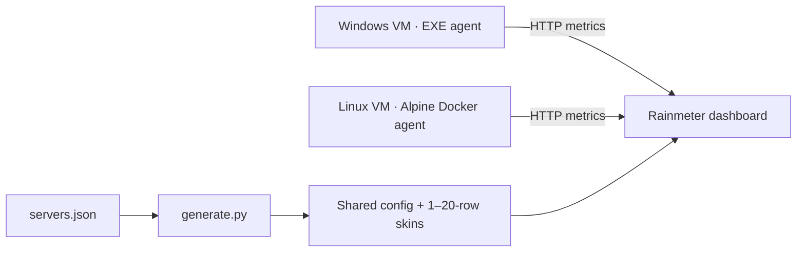

# ServerStats

Lightweight monitoring for Windows and Linux VMs: CPU, RAM, network traffic, disk capacity, and read/write throughput. A compact Rainmeter dashboard displays live values, graphs, and warnings at 80% CPU/RAM/disk usage.

## Architecture

Each VM runs a Python/Flask/psutil agent that collects metrics every second and serves `/api/stats` (JSON) and `/stats` (Rainmeter text). The dashboard polls agents every **2 seconds** by default; values and graphs refresh together. No central server or persistent history is included.



## Run the agents

Run one agent on **each monitored VM**. Default port: **5000**.

**Windows:** run `server_stats.exe`, or build it from source:

```powershell
py -m pip install -r requirements.txt pyinstaller
py -m PyInstaller --noconfirm --onefile --console server_stats.py
.\dist\server_stats.exe
```

**Linux:** requires Docker Engine and Docker Compose.

```bash
docker compose up -d --build server-stats-linux
curl http://127.0.0.1:5000/api/stats
```

**Docker Desktop:** `docker compose up -d --build`. This monitors its Linux environment, **not Windows**; use the EXE for Windows metrics. Do not run both Compose services together.

Optional settings: `SERVER_STATS_HOST`, `SERVER_STATS_PORT`, `SERVER_STATS_DISK`; see `docker.env.example`. In Linux Docker, use `/host/root` for host `/`, or `/host/root/data` for host `/data`.

## Run the dashboard

1. Install **Rainmeter** and **Python 3.9+ with `py.exe`** on the dashboard PC.
2. Copy `ServerStats/` into your Rainmeter `Skins` directory.
3. Edit the installed `@Resources/Aggregate/servers.json`:

   ```json
   {
     "host_title": "MY VMs",
     "scale": 1.0,
     "update_seconds": 2,
     "servers": [
       {"id": "vm01", "address": "192.168.1.11", "port": 5000, "name": "vm-01", "enabled": true}
     ]
   }
   ```

4. Run `rebuild_aggregate.cmd` in the installed `ServerStats` folder.
5. Refresh Rainmeter and load `ServerStats → Aggregate → Aggregate-10.ini` (or another 01–20 variant). `Aggregate.ini` sizes automatically. At 11+ slots, the dashboard uses two columns.

Edit JSON, not generated INI files. Keep your existing `servers.json` when updating. The original single-machine skin remains available.

## Test the demo

Demo mode returns **synthetic metrics** without stressing the machine or changing real `/stats` and `/api/stats` responses. It is selected per dashboard entry using **`demo_load`** in **`@Resources/Aggregate/servers.json`**. This project does not use a `settings.json` file.

1. Start one agent using the Windows or Docker instructions above. A single agent can serve all four demo entries.
2. Check the demo endpoint in a browser: `http://127.0.0.1:5000/api/demo/80`. It should return JSON with `hostname: "DEMO-80"` and `cpu: 80.0`. If you get 404, update/rebuild the agent. For a remote agent, replace `127.0.0.1` with its reachable IP.
3. **Back up your installed `servers.json`**, then temporarily replace its contents with the example below, or add the demo entries to your existing `servers` array. A ready-to-use copy is also available as `servers.demo.json` in the same folder.

   ```json
   {
     "host_title": "DEMO",
     "scale": 1.0,
     "update_seconds": 2,
     "servers": [
       {"id": "demo10", "address": "127.0.0.1", "port": 5000, "name": "DEMO-10", "enabled": true, "demo_load": 10},
       {"id": "demo50", "address": "127.0.0.1", "port": 5000, "name": "DEMO-50", "enabled": true, "demo_load": 50},
       {"id": "demo80", "address": "127.0.0.1", "port": 5000, "name": "DEMO-80", "enabled": true, "demo_load": 80},
       {"id": "demo100", "address": "127.0.0.1", "port": 5000, "name": "DEMO-100", "enabled": true, "demo_load": 100}
     ]
   }
   ```

   `address` is the agent address **as seen from the Rainmeter PC**. Use `127.0.0.1` only if the agent is on that PC; use the VM IP otherwise. Adjust `port` if needed. Each `id` must be unique.

4. Run `rebuild_aggregate.cmd` from the **installed** `ServerStats` folder, then load `Aggregate-04.ini` in Rainmeter. If you kept your real machines too, select a variant with enough slots to include the demo entries. Saving JSON alone does not apply the changes.
5. Check the expected results:

   | `demo_load` | CPU / RAM / disk usage | Network, each direction | Disk read / write | Warning |
   |---|---|---|---|---|
   | `10` | 10% | 10.0 Mbit/s | R 10.0 W 10.0 MB/s | Normal colors |
   | `50` | 50% | 50.0 Mbit/s | R 50.0 W 50.0 MB/s | Normal colors |
   | `80` | 80% | 80.0 Mbit/s | R 80.0 W 80.0 MB/s | Red CPU/RAM and disk indicators |
   | `100` | 100% | 100.0 Mbit/s | R 100.0 W 100.0 MB/s | Red CPU/RAM and disk indicators |

   Demo RAM totals 16.0 GB and disk capacity totals 256.0 GB. For `80`, the displayed values are `12.8 / 16.0 GB (80%)` and `204.8 / 256.0 GB`. The I/O graph shows **read + write**, so its value is 160.0 MB/s at `80`; it remains green even when disk-capacity warnings are red. Disk usage percentage is represented by the pie chart, not separate numeric text.

   Graphs refresh every 2 seconds with this configuration. Values are constant, so lines become horizontal after history fills. These presets test formatting and warnings, **not real performance or changing-load behavior**.

6. To return to real monitoring, restore your backup, or remove `demo_load` / set it to `null` on entries that should show real metrics. Rebuild again and select the appropriate skin. The agent does not need a restart.

**Parameter rules:** `demo_load` accepts only the integers `10`, `50`, `80`, or `100`. It is not a Boolean: do not use `true`, `false`, `0`, or a quoted number. Missing or `null` means real metrics. Rainmeter uses `/demo/N` (text); browsers and web backends can use `/api/demo/N` (JSON). Unsupported demo routes return 404.

## Notes

- **Security:** agents have no authentication or TLS. Allow access only from the dashboard/backend through a trusted LAN/VPN and firewall; never expose agents to the Internet.
- **Units:** network uses adaptive Kbit/s, Mbit/s, Gbit/s; disk I/O uses MB/s. Capacity is labeled GB but calculated in 1024³ bytes.
- **Tests:** `py -m unittest discover -s tests -q`.
- **Web integration:** use `/api/stats` through a trusted backend. A web dashboard is not included.
