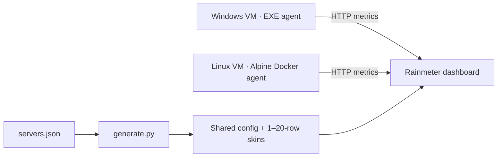

# ServerStats

Lightweight monitoring for Windows and Linux VMs: CPU, RAM, network traffic, disk capacity, and read/write throughput. A compact Rainmeter dashboard displays live values, graphs, and warnings at 80% CPU/RAM/disk usage.

## Architecture

Each VM runs a Python/Flask/psutil agent that collects metrics every second and serves `/api/stats` (JSON) and `/stats` (Rainmeter text). The dashboard polls agents every **2 seconds** by default; values and graphs refresh together. No central server or persistent history is included.



## Run the agents

Run one agent on **each monitored VM**. Default port: **5000**.

**Windows:** run `server_stats.exe`, or build it from source:

```powershell
py -m pip install -r requirements.txt pyinstaller
py -m PyInstaller --noconfirm --onefile --console server_stats.py
.\dist\server_stats.exe
```

**Linux:** requires Docker Engine and Docker Compose.

```bash
docker compose up -d --build server-stats-linux
curl http://127.0.0.1:5000/api/stats
```

**Docker Desktop:** `docker compose up -d --build`. This monitors its Linux environment, **not Windows**; use the EXE for Windows metrics. Do not run both Compose services together.

Optional settings: `SERVER_STATS_HOST`, `SERVER_STATS_PORT`, `SERVER_STATS_DISK`; see `docker.env.example`. In Linux Docker, use `/host/root` for host `/`, or `/host/root/data` for host `/data`.

## Run the dashboard

1. Install **Rainmeter** and **Python 3.9+ with `py.exe`** on the dashboard PC.
2. Copy `ServerStats/` into your Rainmeter `Skins` directory.
3. Edit the installed `@Resources/Aggregate/servers.json`:

   ```json
   {
     "host_title": "MY VMs",
     "scale": 1.0,
     "update_seconds": 2,
     "servers": [
       {"id": "vm01", "address": "192.168.1.11", "port": 5000, "name": "vm-01", "enabled": true}
     ]
   }
   ```

4. Run `rebuild_aggregate.cmd` in the installed `ServerStats` folder.
5. Refresh Rainmeter and load `ServerStats → Aggregate → Aggregate-10.ini` (or another 01–20 variant). `Aggregate.ini` sizes automatically. At 11+ slots, the dashboard uses two columns.

Edit JSON, not generated INI files. Keep your existing `servers.json` when updating. The original single-machine skin remains available.

## Notes

- **Security:** agents have no authentication or TLS. Allow access only from the dashboard/backend through a trusted LAN/VPN and firewall; never expose agents to the Internet.
- **Units:** network uses adaptive Kbit/s, Mbit/s, Gbit/s; disk I/O uses MB/s. Capacity is labeled GB but calculated in 1024³ bytes.
- **Demo:** `/api/demo/10`, `/api/demo/50`, `/api/demo/80`, `/api/demo/100` return synthetic data without creating load.
- **Tests:** `py -m unittest discover -s tests -q`.
- **Web integration:** use `/api/stats` through a trusted backend. A web dashboard is not included.
